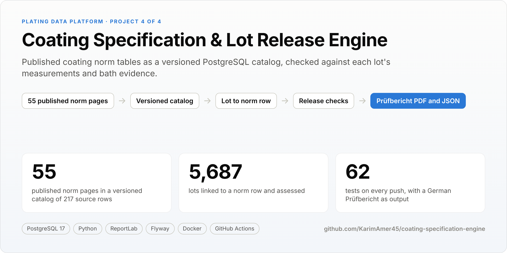
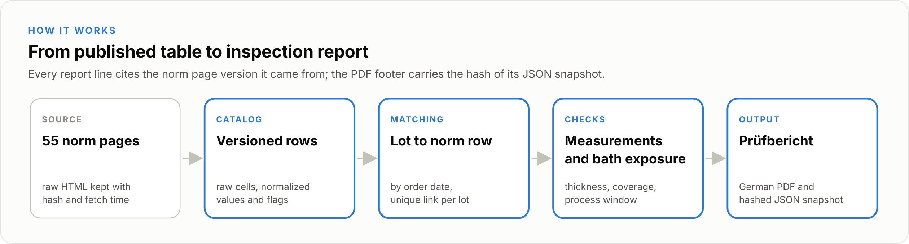
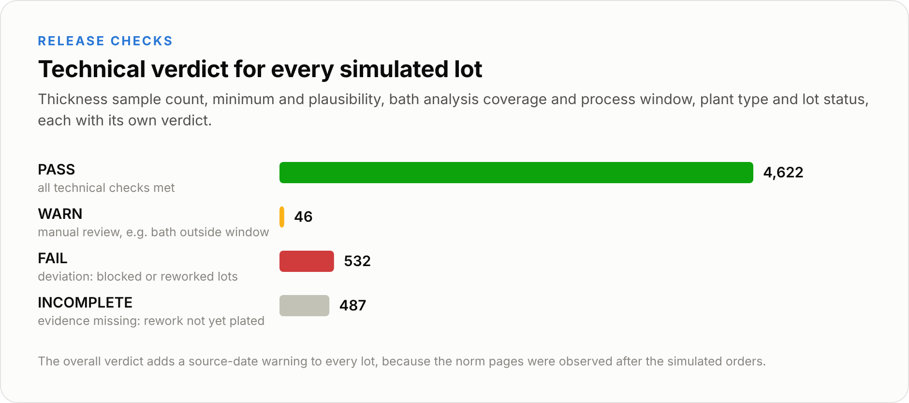
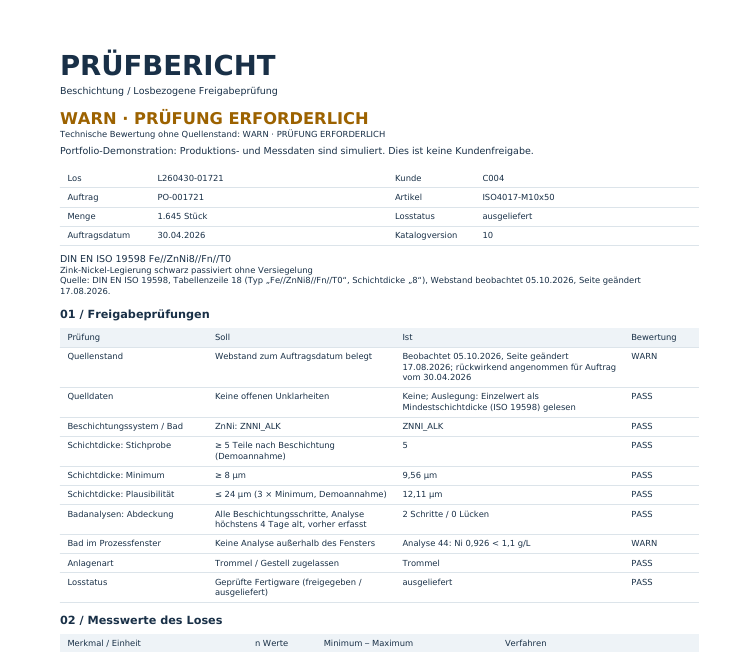

<p align="center"></p>

<p align="center"><a href="https://github.com/KarimAmer45/coating-specification-engine/actions/workflows/verify.yml"></a>    </p>
<p align="center">Plating Data Platform: <a href="https://github.com/KarimAmer45/manufacturing-traceability">Traceability</a> &middot; <a href="https://github.com/KarimAmer45/process-quality-analytics">Lab ETL & SPC</a> &middot; <a href="https://github.com/KarimAmer45/industrial-iot-historian">IoT historian</a> &middot; <b>Specification & release</b></p>

Before a lot ships, someone has to check it against the customer's coating specification. This project turns published coating norm tables into a versioned PostgreSQL catalog, links every lot to the exact table row it was ordered against, checks thickness and bath evidence, and writes a one page German inspection report whose PDF carries the hash of its JSON evidence.

<p align="center"></p>

<table>
<tr>
<td width="58%"></td>
<td width="42%"><br><sub>Generated Pr&uuml;fbericht (<a href="docs/reports/Pruefbericht_L260430-01721.pdf">full PDF</a>)</sub></td>
</tr>
</table>

## Inside the database

- **Versioned source data.** Each norm page is stored with its raw HTML hash and fetch time; catalog rows keep the raw cells next to the normalized values and a quality flag, and a changed page becomes a new version instead of an overwrite.
- **Matching at order date.** Every lot links to exactly one catalog row as it stood when the order arrived; all 5,687 simulated lots link, none are left over.
- **Release checks with evidence.** Thickness sample count, minimum and plausibility, bath analysis coverage and process window, plant type and lot status, each with its own verdict and the rows behind it.
- **Reports as records.** The PDF and its JSON snapshot are generated together; the footer carries the snapshot's hash.
- **Roles and audit.** The lab cannot change a lot's release status, quality cannot turn a supplier reference into a requirement, and changes to lots, requirements and norm versions are audited; 62 tests on every push.

## Run it

```bash
cp .env.example .env    # set SPEC_DB_PASSWORD
docker compose up -d db
docker compose run --rm app        # Flyway migrations, then the offline build
docker compose run --rm app pytest -q tests
```

The build works offline from a local page cache; CI builds from a small synthetic fixture so it never contacts the norm publisher. Details are in the [report](REPORT.md).

## Data

Norm tables come from Partec's public website; the row level extracts are not committed. Orders, lots, measurements and bath analyses are **simulated** from cited public sources, and no customer relationship is implied by a norm name.

---

**Full technical report:** [REPORT.md](REPORT.md) has every result table, the evidence file behind each number, how each part is run and the known limitations.

Built by [Karim Amer](https://github.com/KarimAmer45), M.Sc. Mobile Robotics student at the University of Bonn.
