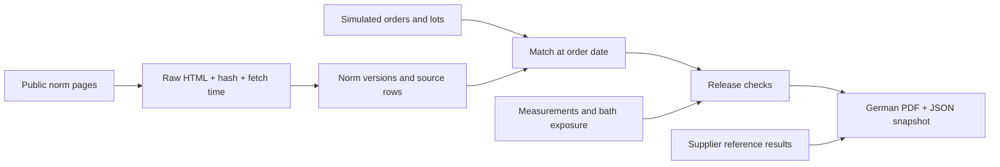

# Coating Specification & Lot Release Engine

I built this project to turn Partec's published coating tables into a versioned PostgreSQL catalog, match simulated orders to individual source rows, and evaluate lot measurements and bath exposure. It produces a one-page German inspection report with a signature field, source citations and a JSON evidence snapshot. The report is a portfolio assessment; it does not change a lot's release status.

The build runs offline from a local page cache and reproduces the numbers below. `python scripts/record_tests.py` runs the test suite and writes the result to [smoke_checks.json](docs/results/smoke_checks.json); the current suite has **62 tests**. The Docker/Flyway path ran cleanly on 2026-10-12; the hosted CI workflow is written but I have not run it yet (see [the open items](docs/FINISHING_CHECKLIST.md)).

## Built result

| Item | Local result |
| --- | --- |
| Public norm pages | 55 parsed from the local cache |
| Catalog | 55 norms / 55 initial versions / 217 source rows |
| Simulated foundation | 5,687 lots / 27,733 measurements |
| Lot matching | 5,687 uniquely linked; zero unlinked |
| Supplier context | 34 reference records on the 17 ZnNi rows whose finish matches the study (black passivated, sealed); zero added release requirements |
| Complaint lot | `L260430-01721`, verdict `WARN`, technical verdict `WARN` |

The complaint lot has five thickness samples, **9.56–12.11 µm**, above its published **8 µm** minimum. Its two plating steps have complete analysis coverage, but the covering analysis 44 was outside the operating window (Ni 0.926 < 1.1 g/L). That yields a process warning. A second warning states that the catalog version was observed after the order date (see below).

Open [the inspection report](docs/reports/Pruefbericht_L260430-01721.pdf), [its exact data snapshot](docs/reports/Pruefbericht_L260430-01721.json), [build counts](docs/results/build_summary.json), [verdicts of all lots](docs/results/verdict_distribution.csv), or [the open items](docs/FINISHING_CHECKLIST.md).



## Verdicts across all simulated lots

Every simulated order (March to August 2026) predates the October observation of the web pages, so every lot carries the source-date warning. To keep good and bad historical lots distinguishable, the export also reports a **technical verdict**: the same checks without the source-date check (`Quellenstand`). The overall verdict stays the conservative one.

| Lots | Origin / status | Verdict | Technical verdict |
| ---: | --- | --- | --- |
| 4,622 | receipt / shipped | WARN | PASS |
| 46 | receipt / shipped | WARN | WARN (bath outside its window) |
| 45 | receipt / blocked | FAIL | FAIL |
| 487 | receipt / reworked | FAIL | FAIL |
| 487 | rework child / received | INCOMPLETE | INCOMPLETE |

Earlier versions of the check left 22 reworked parent lots at `WARN` (two of them technically clean). A reworked parent's pieces have moved to its rework child, so it is now a non-release like blocked or scrapped. All other lots kept their verdict. The 487 rework children stay `INCOMPLETE`: they have no thickness readings of their own, and their only plating exposure is the parent's, which the coverage check reports as a warning.

## Data origin and conservative parsing

| Data | Origin |
| --- | --- |
| Type codes, descriptions, thickness notation, barrel/rack capability | Real published [Partec norm tables](https://www.partec.de/industrie-automobilnormen/), downloaded 2026-10-05 |
| Corrosion reference bounds | Smie, NASF SUR/FIN 2008, [Table 1, PDF page 2](https://nmfrc.org/pdf/sf2008/sf0828.pdf#page=2), read with a web PDF reader |
| Customers, orders, lots, measurements, bath analyses and complaint | Deterministic simulation copied from Project 1; anonymous customers |
| Initial effective date, sampling, analysis age and plausibility limits | Explicit portfolio assumptions in `config/release_policy.yaml` |

The supplier table reports ASTM B117 times **greater than** 120/720 h for blue-passivated ZnNi, and greater than 200/1,008 h for sealed blue and sealed black finishes (white/red corrosion respectively). These are contextual supplier results, not OEM limits or predictions for a particular lot. A result is attached only to catalog rows whose description names the same colour and the same sealing; I do not assume any equivalence between blue, transparent and thick-layer passivation. The strict `>` is stored as the bound's operator. The complaint lot is black passivated without sealer, so its report says that no matching reference exists. Local PDF downloading failed at DNS resolution; the six cited values are kept as a reviewed transcription, with download status recorded separately.

The downloader checks robots.txt, waits at least three seconds between uncached requests, and records each URL, time and SHA-256 hash in `data/raw/partec_norms/manifest.json`, which is also the loader's input. Cached HTML and robots.txt are private under the ignored `data/` folder and are reused unless I ask for a refresh. A refresh archives replaced HTML by hash. Before downloading, set `NORM_FETCH_USER_AGENT` to a User-Agent that includes your contact address; the default is neutral and contains none. The parser retains duplicate table rows in source order instead of silently deduplicating them. Rows preserve all five raw cell texts; "raw" here means extracted cell text, while the full original HTML is retained separately.

The quality report contains these flag occurrences (one row may carry multiple flags):

| Flag | Count | Handling |
| --- | ---: | --- |
| `single_thickness_semantics_unconfirmed` | 177 | Keep the published number in raw cells; do not infer a minimum outside ISO 19598 |
| `coating_system_unparsed` | 17 | Preserve unknown / unsupported descriptions, including phosphate systems |
| `type_code_not_unique` | 12 | Keep every row; ambiguous orders are not linked automatically |
| `slash_fixed` | 3 | Normalize the known ISO designation pattern and retain the original |
| `thickness_missing` | 1 | Missing evidence produces `INCOMPLETE` |

The duplicate counts include the two `Ofl-r645` rows and the repeated Deutz table. The 18 single-value ISO 19598 thicknesses are read as minimum local thickness. That is my interpretation of the designation, not yet checked against the licensed standard text, so every affected report prints it in the `Quelldaten` row ("Auslegung: Einzelwert als Mindestschichtdicke") and the quality report counts it under `interpretation_counts`. Letter/description consistency is checked against the published pairings, not represented as independently validated ISO semantics. Norm names are compared with collapsed whitespace, because one published title contains a double space.

The row-level extracts `docs/results/acquisition.json`, `catalog_quality.json` (all flags), `norm_matrix.csv` and `lot_links.json` are local outputs that every build regenerates. They are git-ignored and not part of the repository; only counts are published.

## History and release behavior

`spec.norm_version` stores effective intervals, the observation time and the page's own modification time (`article:modified_time`, 12–17 August 2026 for the current pages). A version is identified by a hash of the extracted raw cells, and each version records the parser version that produced its normalized columns and flags. A changed page closes its current version and inserts a complete new set of coating rows; a parser-only change creates no new version (the loader prints a note when current versions come from an older parser). Old rows cannot be edited or deleted through normal SQL, and version intervals cannot overlap. A new version must be observed after, and take effect after, the earlier versions of the same page, and a version that starts before its observation date must be marked `historical_assumption`. Matching uses the order's `received_on` date, norm name and exact raw/normalized type designation; row position distinguishes repeated type codes. Same-day changed versions are rejected for explicit review. Removed pages are not automatically retired.

The simulated orders precede the October scrape. To make the demonstration useful, the initial catalog is explicitly backdated to **2026-01-01** and marked `historical_assumption`. This is not a claim about an OEM norm's historical validity. Every affected lot receives a `Quellenstand` warning that names the observation date, the page's modification date and the order date. An order that falls between two observations of a page that changed in between also gets this warning, unless the later page's modification date shows the change came after the order. Without the explicit backdate option, the loader defaults to the observed date and older orders stay unmatched.

The assessment checks:
- unique linkage at the order date (a missing, ambiguous or stale link is `INCOMPLETE` with the reason; the checks that do not need the catalog row still run);
- unresolved source flags;
- coating system against the plating process of every plating step (ZnNi needs `ZNNI_ALK`, zinc needs `ZN_ALK`; a mismatch is `FAIL`, an unparsed or unmapped system is `INCOMPLETE`);
- distinct non-null thickness samples, minimum and maximum thickness, counting only readings taken after the plating they measure had ended (earlier readings make the sample `INCOMPLETE`);
- a plausibility bound on minimum-only specifications: readings above 3 × the minimum are `INCOMPLETE`;
- cited additional requirements, with their unit checked against the measured characteristic;
- plating-analysis coverage: an analysis counts for at most **4 days** after sampling, measured in Berlin local time so a DST change does not shift the cut (the simulated lab samples once per working day; four days cover a weekend plus one missed day), and it must report every limited parameter. A lot whose only plating is its rework parent's, or a dwell covered by an analysis that was entered after the dwell ended ("Analyse nachgetragen"), is a `WARN`;
- out-of-window bath exposure, naming the analysis, parameter, value and limit (the first three; the JSON lists all);
- handling capability (barrel/rack) of the carriers that went through plating; a lot without plating of its own is `INCOMPLETE` here;
- lot status: only released or shipped lots can pass. Blocked, scrapped and reworked lots `FAIL`; received or in-process lots are `INCOMPLETE`.

`lab.analysis.entered_at` is set by the database when an analysis is inserted; the client cannot choose it. The analyses that existed before this column, and the simulator's bulk load of six months of analyses, have no real entry time; they are recorded as entered at their sampling time. That is an assumption of the demo, so the late-entry warning only applies to analyses entered afterwards.

Ancestors contribute bath exposure, and the coverage row says how many steps came from the rework parent; their measurements are never reused as the child's final inspection evidence. Supplier rows with `kind='reference'` are excluded from verdicts and cannot be turned into requirements.

Severity is `FAIL` > `INCOMPLETE` > `WARN` > `PASS`. Missing measurements, missing or stale analysis coverage, missing bath parameters, unmatched coating systems and unfinished lots cannot produce a clean pass. The policy values live in `config/release_policy.yaml` and are copied into `spec.release_policy` (audited) during the build. The five-sample threshold, the 4-day analysis age and the 3 × plausibility factor are demonstration assumptions, not an AQL plan. Bath limits use the foundation model's sampling-date validity convention; changes to limits during a dwell need additional review. Full OEM standards, corrosion acceptance criteria, hydrogen embrittlement, friction and customer-specific inspection plans are not inferred from the website.

Reports use one read-only repeatable-read database snapshot. The PDF presents measurement ranges and names the deviating analysis in the "Ist" column (for the complaint: "Analyse 44: Ni 0,926 < 1,1 g/L"). The companion JSON contains every measurement, the bath evidence (analyses, parameters, values, limits, validity and counted coverage intervals per plating step), the catalog provenance (version, observation and page modification times, backdate flag, row flags and raw cells), the release policy, both verdicts and the matching references. The sentence about the retroactively assumed web version is printed only when it applies to that order, with both dates. The JSON is written as UTF-8 with LF line endings, and the footer prints the first 16 hex digits of its SHA-256, so `sha256sum` of the shipped JSON starts with the footer value on any system. The fonts (Bitstream Vera, shipped with ReportLab) are embedded. The generator refuses to publish a report that spills past one page (or has a single cell taller than a page) rather than truncating evidence; in that case it writes nothing and moves an older pair for the same lot to `docs/reports/superseded/`.

Requirement edits re-score history: `spec.release_check` always evaluates the current requirements, so rerunning a report after a cited requirement changed can give a different result. Changes are audited, but the issued PDF/JSON pairs are the record of what was assessed; keep them.

## Run locally

Python 3.12 or newer and PostgreSQL 16 or 17 are required. The folder contains a complete copy of the foundation migrations and simulator: it does not query the other projects at runtime.

```powershell
python -m pip install -r requirements.txt
# Configure PGHOST, PGPORT, PGUSER, PGPASSWORD and PGDATABASE for a dedicated empty database.
python scripts/build.py              # offline when data/raw/partec_norms is complete
python scripts/build.py --offline    # never touches the network; fails if the cache is incomplete
python scripts/record_tests.py       # runs pytest and writes docs/results/smoke_checks.json
```

A fresh checkout has no page cache. The first build then downloads the pages once; set `NORM_FETCH_USER_AGENT` (with your contact address) first. `python scripts/build.py --refresh-norms` re-downloads everything. If a page fails to download, a valid cached copy is kept and the error is noted in the manifest (`last_error`); a page without a valid copy is marked failed, and the build stops instead of loading a partial catalog.

My native installation is isolated on **127.0.0.1:55436**, database `coating_spec`. Its random password lives in ignored `.env`. Start it and run the wrapper with a Python interpreter on PATH (or pass `-Python <path-to-python>`):

```powershell
./scripts/local-db.ps1 start
./scripts/project.ps1 build
./scripts/project.ps1 record-tests
./scripts/project.ps1 report
```

To update an existing database, run `./scripts/project.ps1 migrate` (or `python scripts/migrate.py`), then `./scripts/project.ps1 policy`, `python scripts/load_references.py`, `./scripts/project.ps1 export` and `./scripts/project.ps1 report`. Extra local packages in ignored `.local/pydeps` are added by the wrapper automatically.

For another Windows checkout with a portable PostgreSQL distribution:

```powershell
python scripts/bootstrap_local.py --postgres-dir C:/path/to/pgsql
./scripts/project.ps1 build
```

The bootstrap copies only PostgreSQL binaries, initializes a new cluster and creates a new database. The wrapper's `catalog` action deliberately uses the initial demo effective date. For later changed source versions, use the loader directly with its default observed date:

```powershell
python scripts/download_data.py --refresh-norms
python ingest/p4_partec_norms.py
python scripts/load_references.py
python ingest/p4_release_report.py L260430-01721
```

Direct Python commands require the connection environment to be set; the PowerShell wrapper reads `.env` for its supported actions. Do not rerun the seed command on a populated database. The build checks for existing lots and skips seeding.

## Docker and CI

Set a private `SPEC_DB_PASSWORD` in `.env` first. Docker uses host port 55437 so it can coexist with the native database.

```powershell
docker compose up -d db
docker compose run --rm migrate
docker compose run --rm app python scripts/build.py --skip-migrate
docker compose run --rm app pytest -q tests
```

I ran these four commands on 2026-10-12 with Docker Desktop on Windows: Flyway 11.20.3 applied all 12 migrations to a fresh PostgreSQL 17.11 container (up to V015), the build verified the 55 cached pages and reproduced 217 catalog rows, the same flag counts and the same verdict counts (4,622 WARN/PASS, 46 WARN/WARN, 532 FAIL, 487 INCOMPLETE; complaint lot WARN/WARN), and all 61 tests in the suite at that time passed (the test for rebuilding after a changed page was added afterwards). Since that run the `app` service waits for the Flyway service and runs the build by default; I have not re-run Docker after that change. The report pair committed in `docs/reports/` comes from my native run; a Docker build writes its own pair with a different timestamp and hash. I have not run the GitHub Actions workflow.

Flyway runs in Docker/CI. The native migration runner has an independent checksum ledger and refuses a Flyway-managed database. Do not mix the two runners. The CI workflow never contacts the norm publisher: it builds from a small synthetic fixture (`tests/fixtures/norm_pages`) with `--norm-source`. The fixture rows are invented for the tests: only the standard designations are reused so that the simulated orders link, while descriptions, thickness ranges and capabilities are made up and marked as test rows. It assumes this project folder is the repository root.

Roles separate operator, laboratory, quality, ingest and read-only access. Tests verify that `role_lab` cannot update lot release status, cannot move or delete a bath analysis (corrections go into `lab.analysis_result`, and a new analysis is audited), and that quality cannot turn a supplier reference into a requirement. Changes to lots, measurements, analyses, limits, loads, deliveries, requirements, the release policy and norm versions are audited. The bootstrap owner is for local administration, not an operational application login.

## Known limitations

- The single-value ISO 19598 interpretation, the sampling threshold, the analysis age and the plausibility factor are my assumptions, not a customer-approved sampling plan.
- The catalog's historical validity before October 2026 is assumed, and flagged on every affected lot.
- Requirement edits re-score earlier lots (see above); issued report pairs are the record.
- Analysis entry times are real only for analyses entered after `entered_at` was added; earlier and simulated analyses are assumed to have been entered when sampled.
- The supplier PDF has not been saved locally; the six values are a transcription, which I checked against Table 1 of the nmfrc.org copy on 2026-10-11.
- Hosted CI has not been run.
